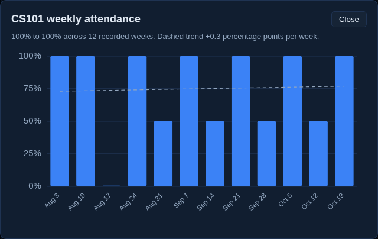
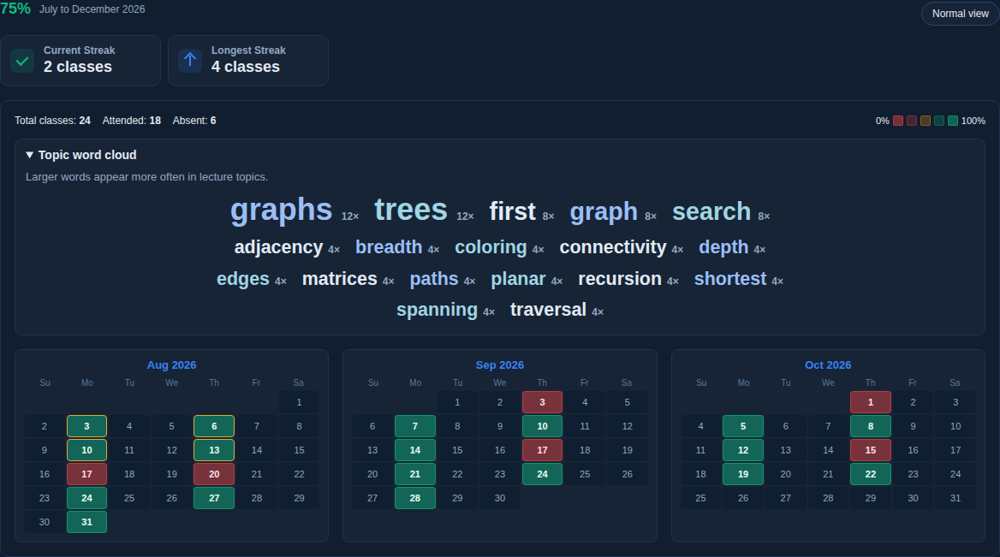

<div align="center">

<br />
<div align="center">
  <pre>
███╗   ██╗ ██╗ ████████╗   ██╗    ███████╗ ██████╗  ██████╗ 
████╗  ██║ ██║ ╚══██╔══╝   ██║    ██╔════╝ ██╔══██╗ ██╔══██╗
██╔██╗ ██║ ██║    ██║      ██║    █████╗   ██████╔╝ ██████╔╝
██║╚██╗██║ ██║    ██║ ██   ██║    ██╔══╝   ██╔══██╗ ██╔═══╝ 
██║ ╚████║ ██║    ██║ ╚█████╔╝    ███████╗ ██║  ██║ ██║     
╚═╝  ╚═══╝ ╚═╝    ╚═╝  ╚════╝     ╚══════╝ ╚═╝  ╚═╝ ╚═╝     
  </pre>
</div>

### **ERP Utils** &nbsp;·&nbsp; Unofficial NITJ Browser Extension

[](./LICENSE)
[](https://vitejs.dev)
[](https://crxjs.dev)
[](https://developer.mozilla.org/en-US/docs/Web/JavaScript)

<br />

> _Your NITJ ERP, the way it should have been._

<br />

</div>

---

## What It Does

**NITJ ERP Utils** is a lightweight browser extension that layers useful functionality on top of the NITJ ERP: making attendance trends easy to spot, polishing the interface with dark mode, and doing the what-if math students shouldn't have to do.

<br />

## Features

|     | Feature                           | Description                                                                                           |
| --- | --------------------------------- | ----------------------------------------------------------------------------------------------------- |
| 🌙   | **Dark Mode**                     | Dark theme for comfortable night-time browsing                                                        |
| 📊   | **Attendance Dashboard**          | See overall attendance in a 10×10 waffle chart and compare subjects in a collapsible box plot summary |
| 🎯   | **What-If Planner**               | Pick 72%, 75%, or a custom target and see how attending or missing classes changes your percentage    |
| 🧮   | **Attendance Deficit Calculator** | Instantly see how many classes you need to attend (or can skip) at your selected target               |
| 📈   | **Weekly Trends**                 | Expand a subject's bar chart to see week start dates, a trendline, and how attendance is changing     |
| 📅   | **Interactive Calendar**          | See daily attendance in a color-coded calendar and hover over a day for lecture details               |
| 🏅   | **Attendance Streaks**            | Track current and longest streaks, with gold borders on the latest longest run in the calendar        |
| 💬   | **Topic Word Cloud**              | Open an animated word cloud in the calendar to see which lecture topics come up most often            |
| ⚡   | **Lightweight & Fast**            | Attendance tools run in your browser with data already in the ERP                                     |
| 🦊   | **Cross-Browser**                 | Works on Chrome, Brave, Opera, Firefox, and Zen                                                       |

<br />

## Preview

> Dark mode support across the ERP interface.


> Attendance dashboard with an overall waffle chart, a subject box plot, and the What-If Planner.


> Expanded weekly bar chart with week start dates and a dashed trendline.



> Interactive calendar with the topic word cloud open and the latest longest streak outlined in gold.



<br />

---

## Installation

### Chromium-based browsers

_(Chrome, Brave, Opera, Edge)_

```bash
# 1. Clone
git clone https://github.com/Opensource-NITJ/nitj-erp-utils.git
cd nitj-erp-utils

# 2. Install dependencies
npm install

# 3. Build
npm run build
```

Then in your browser:

1. Navigate to `chrome://extensions`
2. Enable **Developer Mode** (top right toggle)
3. Click **Load unpacked**
4. Select the `dist/chromium` folder

---

### Firefox

```bash
npm run build
```

1. Open `about:debugging#/runtime/this-firefox`
2. Click **Load Temporary Add-on**
3. Select `dist/firefox/manifest.json`

For **Flatpak browsers such as Zen**, load a ZIP of the build instead. The file picker may grant access only to `manifest.json`, leaving the extension's scripts and icons inaccessible.

```bash
# From the project root, after building
cd dist/firefox
zip -r ../nitj-erp-utils-firefox.zip .
```

Select `dist/nitj-erp-utils-firefox.zip` from the project root in **Load Temporary Add-on**, then refresh the ERP tab.

<br />

---

## Building from Source

### Requirements

- **OS:** Linux, macOS, or Windows
- **Node.js:** v20 or later ([download](https://nodejs.org/))
- **npm:** v10 or later (included with Node.js)

### Steps

```bash
# 1. Install dependencies
npm install

# 2. Build the Firefox extension
npm run build:firefox
```

The built extension will be in `dist/firefox/`.

To build for Chromium-based browsers instead, run `npm run build:chromium`. To build both, run `npm run build`.

## Development

```bash
# Start dev server with HMR
npm run dev

# Production build (outputs to dist/)
npm run build
```

<br />

---

## Tech Stack

| Layer               | Technology                       |
| ------------------- | -------------------------------- |
| Build tool          | [Vite](https://vitejs.dev)       |
| Extension framework | [CRXJS](https://crxjs.dev)       |
| Language            | JavaScript                       |
| Browser targets     | Chrome · Brave · Opera · Firefox |

<br />

---

## Disclaimer

This is an **unofficial** utility extension. It is not affiliated with, endorsed by, or connected to NIT Jalandhar in any capacity. Use at your own discretion.

<br />

---

## Contributing

Found a bug or want to add a feature? Open an issue or submit a pull request! Contributions are welcome :\)

1. Fork the repository
2. Create a feature branch: `git checkout -b feat/your-feature`
3. Commit your changes: `git commit -m 'feat: add your feature'`
4. Push and open a PR

<br />

---

## License

```
The MIT License (MIT)

Copyright © 2026 Opensource@NITJ <opensourcenitj@gmail.com>

Permission is hereby granted, free of charge, to any person obtaining a copy
of this software and associated documentation files (the "Software"), to deal
in the Software without restriction, including without limitation the rights to
use, copy, modify, merge, publish, distribute, sublicense, and/or sell copies
of the Software, and to permit persons to whom the Software is furnished to do
so, subject to the following conditions:

The above copyright notice and this permission notice shall be included in all
copies or substantial portions of the Software.

THE SOFTWARE IS PROVIDED "AS IS", WITHOUT WARRANTY OF ANY KIND, EXPRESS OR
IMPLIED, INCLUDING BUT NOT LIMITED TO THE WARRANTIES OF MERCHANTABILITY,
FITNESS FOR A PARTICULAR PURPOSE AND NONINFRINGEMENT. IN NO EVENT SHALL THE
AUTHORS OR COPYRIGHT HOLDERS BE LIABLE FOR ANY CLAIM, DAMAGES OR OTHER
LIABILITY, WHETHER IN AN ACTION OF CONTRACT, TORT OR OTHERWISE, ARISING FROM,
OUT OF OR IN CONNECTION WITH THE SOFTWARE OR THE USE OR OTHER DEALINGS IN THE
SOFTWARE.
```

<br />

<div align="center">

Made with care by [Opensource@NITJ](https://github.com/Opensource-NITJ)

</div>
